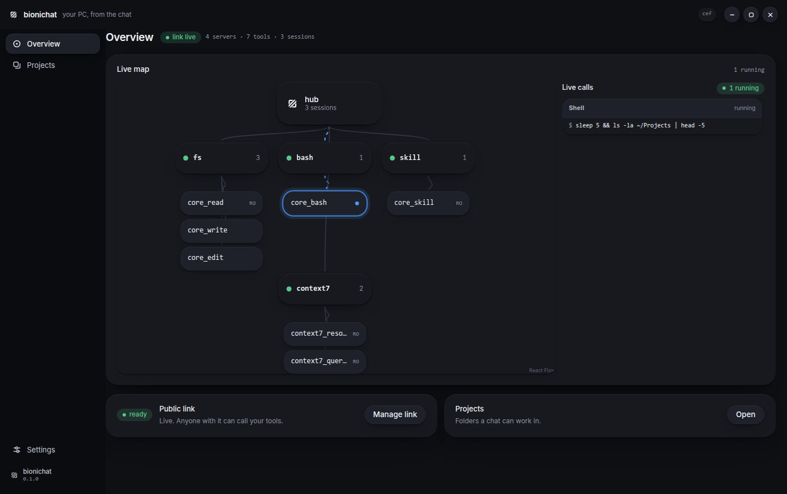

# bionichat

[](https://github.com/youssefvdel/bionichat/actions/workflows/desktop.yml)
[](LICENSE)
[](CHANGELOG.md)
[](#platforms)

Your own PC, from any chat. bionichat runs a small hub on your machine and
gives a web AI like ChatGPT, Gemini or Claude your files, your shell and your
skills, over plain MCP. Nothing is installed in the cloud: the chat calls a
public link, the link reaches your PC.

Dark desktop app (Tauri v3 alpha + Rust, bundled Chromium via CEF), React +
Vite + Tailwind dashboard: Overview with a live map of every tool call,
Projects as folder cards, Settings for the link, servers, per-tool policy and
the built-in tools.

- built-in tools: `core_read` (text, images, PDF, docx, xlsx), `core_write`,
  `core_edit`, `core_bash`, `core_skill`
- any MCP server can be added in Anthropic's `mcpServers` JSON shape; a
  built-in one lives beside the app, an added one starts on its own
- every call carries a server-time stamp so the model knows when it acted
- packaging: one zip per platform, unzip and run, Chromium included

Verified on Linux and Windows 11: build, public link, tool calls, images,
PDF/docx/xlsx, and a fresh unzip of the release folder.




## The public link

A chat app on the web cannot reach `127.0.0.1`, so the app publishes the hub
through OpenTunnel:

- **stable hostname per machine.** The link is
  `https://<id>.opentunnel.xyz/mcp` (the `/mcp` path is the endpoint a chat
  app wants; the bare host answers 404). It comes from the stored tunnel
  identity, so it survives restarts and you paste it into the chat once.
- **nothing to install.** The app ships its own client, `bionichat-tunnel`,
  beside `bionichat`. Upstream `opentunnel` refuses to build outside Unix (its
  service speaks over a Unix socket), so bionichat builds the portable library
  into a small foreground helper: `cargo build -p bionichat-tunnel`,
  or `bun run tunnel:build` to build and place it.
- **Stop** kills the helper and keeps the hostname. **Revoke** deletes the
  tunnel server-side, so the next start mints a new hostname and a leaked link
  is dead for good.
- The helper uses the same profile and identity directory as the upstream CLI,
  so an existing URL keeps working.
- `BIONICHAT_TUNNEL_AUTOSTART=1` brings the link up with the app.
- Settings → Tunnel has two switches: *Start the link when the app opens* and
  *Open with no window next time*. They live in `settings.json` beside
  `registry.json`, so a machine can be set up once and left headless.
- When the link fails, the reason lands in `tunnel.log` in the same folder:
  which helper was started, the public URL, and the helper's own last output.

## Platforms

Linux and Windows are built and driven end to end; macOS compiles in CI but has
never run on a Mac. `PLATFORMS.md` has the full matrix, `WINDOWS.md` and
`MACOS.md` the per-platform details.

## Run

```bash
cargo tauri dev          # or: bunx @tauri-apps/cli@3.0.0-alpha.6 dev
```

`beforeDevCommand` compiles the frontend (`bun build`) and the two demo MCP
servers, so one command is enough on a clean tree.

The bundled-Chromium renderer (CEF) is the default: one engine, the same
pixels on Linux and Windows. Building it needs a C++ chain — `cmake` and
`ninja` (plus MSVC on Windows); the first Linux build also pulls gtk4 and a
~700 MB CEF download.

```bash
cargo build -p bionichat                             # CEF, the default
cargo build -p bionichat --no-default-features --features wry   # opt-out
```

Build from the repository root so every binary lands in one `target/`; a
`--manifest-path src-tauri/Cargo.toml` build silently creates a second
`src-tauri/target/` and the packer then sees stale files.

The frontend is embedded into the binary at compile time, and cargo does not
notice a changed `dist/` on its own. After any UI change, touch the build
script before building, or the app ships the previous screen:

```bash
touch src-tauri/build.rs && cargo build -p bionichat
```

`cef` and `wry` are mutually exclusive (gtk4 vs gtk3); the crate refuses to
build with both. Windows needs Ninja on PATH (`winget install Ninja-build.Ninja`)
and CMake (`winget install Kitware.CMake`).

CEF needs Chromium's SUID sandbox helper to be root-owned, otherwise the
renderer aborts at startup. The build already installs a correct helper under
`target/cef/debug/`, so run the app through the wrapper — it hides the
non-setuid copy the build also drops beside the binary and points
`CHROME_DEVEL_SANDBOX` at the real one, no sudo needed:

```bash
scripts/run-cef.sh            # same binary, CEF sandbox satisfied
```

If you prefer the manual route instead:

```bash
sudo chown root:root target/debug/chrome-sandbox
sudo chmod 4755 target/debug/chrome-sandbox
```

Verified 2026-11-22: the CEF build renders the dashboard and the live map on
Linux and on Windows (six Chromium processes, window painting). The renderer
chip in the header shows which runtime built ("cef" or "wry").

## Package a folder

```bash
bun run package      # -> dist/bionichat-<platform>-<version>.zip
```

One archive holds the app, `fs`, `bash`, `skill`, the tunnel helper and, for a
CEF build, Chromium's runtime (`libcef`, `.pak` files, `locales`, the sandbox
helper). Unzip anywhere and launch; nothing to install.

Measured 2026-11-22:

| platform | zip | unpacked | runtime inside |
|---|---|---|---|
| Linux x64 | 365 MB | 1.5 GB | `libcef.so`, 221 locale files |
| Windows x64 | 192 MB | 453 MB | `libcef.dll` 276 MB |

Two traps the script now handles: a CEF runtime directory is matched by name
(`cef_*`, `*.framework`), because cargo also drops a stray `libcef.dll` inside
its build tree; and the staging folder lives in `target/package/`, never in
`dist/`, which Tauri embeds as the frontend.


## Layout

```
src-tauri/src/lib.rs      app setup, state, commands
src-tauri/src/registry.rs Anthropic JSON parsing + registry.json persistence
src-tauri/src/mcp.rs      rmcp client: spawn → handshake → tools/list → call
src-tauri/src/hub.rs      one MCP endpoint over every server, policy, activity
src-tauri/src/tunnel.rs   opentunnel route lifecycle
src/                      dashboard source (React + Vite + Tailwind)
  views/                  Overview, Projects, Settings
  components/ToolFlow.tsx live graph of hub → servers → tools
  components/LiveRail.tsx running and recent calls
tools/fs                  MCP server: read, write, edit
tools/bash                MCP server: bash
tools/skill               MCP server: skill (list + read from .agents/skills)
dist/                     bun run build output
```

## Tool names

Every tool is namespaced by its server, so a name never lies about where it
came from and two servers can never collide:

- built-ins share the `core` namespace: `core_read`, `core_write`,
  `core_edit`, `core_bash`, `core_skill`
- `core_read` answers images (PNG, JPEG, GIF, WebP, BMP, up to 8 MB) as an MCP
  image block next to a text line, so a vision-capable chat can look at a
  screenshot or a photo instead of being told it is binary
- `core_read` turns documents into text on the machine, so every client can
  use them, Gemini included: PDF (text layer, 32 MB, 60k characters), Word
  `.docx` (paragraphs, tabs, table cells) and Excel `.xlsx`/`.xls` (one block
  per sheet, tab-separated rows). An encrypted or renamed `.doc` is refused
  with that reason instead of a raw zip error
- every other server uses its own name: `context7_query-docs`

A call needs no `tools/list` first: the hub resolves the prefix itself, so the
first call after a restart is as fast as the tenth. Listings answer from the
last known listing, so a slow server (anything behind `npx`) cannot stall an
agent's first call.

Servers are added and removed from Settings → Servers. Removing one drops its
process, its tools and its stored policies. The built-in `core` servers cannot
be removed: they are the app's own hands, and the backend refuses even if a
call comes from somewhere else. A registry file that will not
parse is never overwritten: the app keeps a `.bad-<epoch>` copy and refuses to
reseed over it.

## The live map

Settings → Tools draws the hub, every server and every tool as a graph, and
lights the path up while a call is in flight.

Projects is a picker, not a listing: you choose any folder on this machine and
it becomes a project the chat will work in. Saved in
`<data>/projects.json`; a folder that later disappears drops itself. The public link itself is never printed there, only
inside Settings → Tunnel, where copying happens. Projects lists the folders in `~/Projects` (your own
work, not MCP servers). Everything about the bridge — servers, tool policies,
the live map, the tunnel — lives in Settings, pinned to the bottom of the
sidebar.

- The hub emits `tool-start` the moment a call arrives, before policy runs,
  and `tool-activity` when it finishes. The graph marks the tool blue with a
  dashed edge from the hub while it runs.
- A finished call keeps a ring for 6 seconds (green ok, red failure), then
  fades. Nothing stays coloured forever.
- Followed calls read like a terminal, not JSON: the rail shows the kind
  (Shell / Read / Write / Edit), the command or path, then the output, with
  a Show all toggle for long runs.
- Navigation is custom, so it works in the embedded CEF window: pan and zoom
  the canvas, click a tool for its description.
- `bun run debug-page` writes `dist/_debug.html`: the real bundle against
  fixture data, so the UI can be driven in a normal browser with DevTools.


## Commands (Tauri IPC)

| command | purpose |
| --- | --- |
| `dashboard` | rows + hub + tunnel + approvals/renderer metadata |
| `refresh` | re-probe every registered server through the hub sessions |
| `add_servers { json }` | validate Anthropic JSON, save, spawn, list tools |
| `tunnel_start` | spawn `opentunnel route add <port>`, scrape URL, poll it |
| `tunnel_stop` | kill the tunnel child, back to `off` |
| `tunnel_revoke` | remove the route (URL dies), then stop |
| `resolve_session` | approve once + remember until the app quits |

## Hub

`http://127.0.0.1:8787/mcp` (override with `BIONICHAT_HUB_PORT`). JSON-RPC over
POST, no SSE. Every tool result carries a server-time stamp (`[server time <local> = <UTC>]`) so web agents stay time-aware.

Tools keep their plain names while unique (`read`, `bash`); on a collision they fall back to `server__tool`.
Calls route to the owning server over its live stdio session.

```bash
curl -s -H 'Content-Type: application/json' \
  -d '{"jsonrpc":"2.0","id":1,"method":"tools/list"}' \
  http://127.0.0.1:8787/mcp

curl -s -H 'Content-Type: application/json' \
  -d '{"jsonrpc":"2.0","id":2,"method":"tools/call",
       "params":{"name":"read","arguments":{"path":"demo.txt"}}}' \
  http://127.0.0.1:8787/mcp
```

Handled: `initialize`, `notifications/*` (202), `ping`, `tools/list`,
`tools/call`; anything else returns `-32601`, unknown tool names `-32602`,
malformed JSON HTTP 400, `GET /mcp` 405. A server that fails to start is left
out of the union and reported in the dashboard row, not in the hub response.

Rows carry `name`, `transport`, `secret_keys`, `status`
(`pending`/`ready`/`error`), `error`, `tools`. Env **values** never leave the
backend; the UI shows key names only.

## State and secrets

- Registry: `<app data dir>/registry.json`, seeded with the two demo servers on
  first launch.
- Demo filesystem root: `<app data dir>/demo-root`.
- No shell/fs plugin is installed; the only filesystem access is `demo-fs`,
  which canonicalises every path and rejects escapes.

## Pinned versions

| crate / package | version | why |
| --- | --- | --- |
| `tauri` | `=3.0.0-alpha.6` | latest v3 alpha, has the CEF runtime + MCP plugin |
| `tauri-build` | `=3.0.0-alpha.4` | newest build crate in the v3 line |
| `tauri-runtime-wry` | `=3.0.0-alpha.6` | default runtime, matches core |
| `tauri-runtime-cef` | `=3.0.0-alpha.7` | CEF runtime; pins `cef =154.5.0` and tauri alpha.6 |
| `rmcp` | `=3.11.0` | official Rust MCP SDK (client + server) |
| `@tauri-apps/cli` (bunx) | `3.0.0-alpha.6` | only needed if `cargo tauri` is absent |

## Tunnel

One click runs `opentunnel route add <port>` (or `$OPENTUNNEL_BIN`), scrapes the
`https://…` line it prints, then polls `<url>/mcp` with an MCP `ping` for up to
60 s before showing `ready`.

- **Install** (user-local, no sudo, no account): `npm install -g --prefix "$HOME/.local" opentunnel`
  → `~/.local/bin/opentunnel` (6.5 MB). Removal: `npm uninstall -g --prefix "$HOME/.local" opentunnel`
  and `rm -rf ~/.local/state/opentunnel`.
- **Side effect**: `route add` registers and enables a systemd *user* service
  (`opentunnel-default.service`) so the tunnel survives reboots. `Stop` runs
  `opentunnel down`, which stops it and removes that unit. Stop is per-profile,
  not per-app: it also takes down a tunnel started outside this app.
- Routes stay configured while stopped, so starting again reuses the same URL.
- **Revoke link** burns the route (`opentunnel route remove`) and stops the
  service: the URL dies for good, the next start mints a fresh random one.
  Use it when a link leaks.
- Public URL = public. It serves the hub as-is: demo data only, no auth.

Verified 2026-11-20 on this box (tunnel `kfgepc72im6k.opentunnel.xyz`):

| check | result |
| --- | --- |
| app `Start tunnel` | `ready`, URL shown in the card |
| TLS chain | `ZeroSSL ECC DV SSL CA 2`, openssl verify `0 (ok)` |
| `POST /mcp tools/list` from the internet | `demo-ping__ping`, `demo-ping__echo`, `demo-fs__fs.read` |
| `POST /mcp tools/call demo-ping__ping` | `pong` |
| app `Stop` | service stopped, public URL stops answering |

## Known gaps (next passes)

- P3: per-tool Allow/Ask/Deny, restart supervision, external-kill detection,
  re-reading the registry when the file changes outside the app.
- Hub is JSON-RPC over POST only; SSE streaming and `Mcp-Session-Id` are not
  implemented, so clients that require SSE will not connect.
- Tool calls through the hub are unbounded: no per-call timeout, and the
  approvals policy is not enforced yet.
- HTTP/SSE transports parse and persist but probe returns
  "not wired yet (P2)".
- Approvals are shown as the default policy only; nothing enforces them yet.
